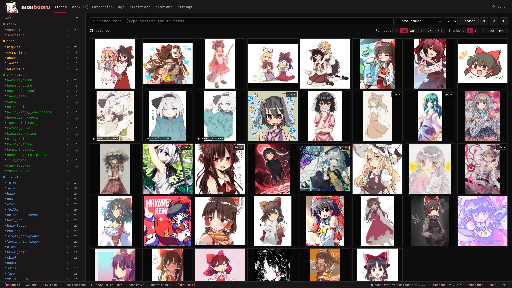

monbooru is a private booru that runs on your own machine. A booru is
an image gallery you browse with tags instead of folders: you give
pictures tags like `red_hair`, `character:hakurei_reimu` or
`rating:general`, then find them again by combining tags in a search.
If you have thousands of images and can never find the one you want,
monbooru might help.

It's made for a local collection: your photos and videos, downloaded
art, manga archives. Your files stay ordinary files in ordinary
folders. monbooru watches those folders and keeps what it knows about
them (tags, ratings, relations) in its own database, so removing it
leaves your files exactly where they were.

monbooru never goes on the internet by itself. Downloading from boorus
and looking up where an image came from are the job of the optional
[addons](addons/_index.md).

> **Keep it on your home network.** monbooru is meant for a trusted
> network or a private VPN. It has an optional password but
> isn't made for exposure to the open internet. If you expose it anyway,
> put it behind a reverse proxy with proper protections.

## What it can do

- Tag and [search](guides/searching/index.md) your collection, with
  categories, ratings and a safe-for-work ceiling you can flip on when
  someone's looking over your shoulder.
- Pick up new files on its own and put them in an
  [inbox](guides/inbox/index.md) until you've had a look.
- Read the prompts and settings Stable Diffusion tools save in their
  images. See [AI metadata](guides/ai-metadata.md).
- [Tag images for you](guides/auto-tagger/index.md) with a model
  running on your own CPU or GPU.
- Show images, videos and animated GIFs, and read CBZ/ZIP archives in
  a built-in [manga reader](guides/manga/index.md).
- Find [near-duplicates and variants](guides/relations/index.md) and
  keep track of which is which.
- Hold several [galleries](guides/galleries/index.md), and
  [import a library](guides/migrating.md) from supported apps.

## Where to start

[Install](getting-started/install.md) it, then follow
[First steps](getting-started/first-steps/index.md) to add and tag your
first images. The [guides](guides/_index.md) cover each feature in
turn, and [Advanced](advanced/_index.md) has the config file, GPU
setup, themes and the API.

## Addons

monbooru works fine on its own. Two optional companions add online capabilities:

- **[monloader](addons/monloader/_index.md)** downloads posts from booru
  sites into your collection, tags included, and finds tags and
  sources for images you already have.
- **[monsender](addons/monsender/_index.md)** is a browser extension
  that sends the page you're looking at to monloader in one click.

The [addons overview](addons/_index.md) explains how they fit
together.
