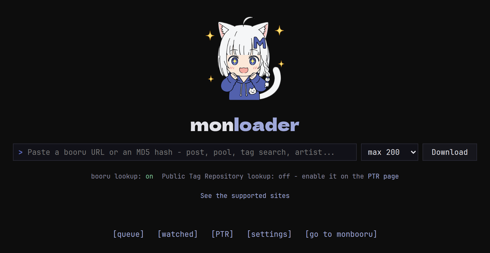

monloader is the downloader that feeds [monbooru](../../_index.md).
Give it the URL of a booru post, a pool, a tag search, an artist page
or a plain image link, and it fetches the files along with their tags,
rating and source, and hands them to monbooru.

The downloading itself is done by
[gallery-dl](https://github.com/mikf/gallery-dl), so any site
gallery-dl supports works. monloader adds a download queue, turns each
site's tags and ratings into monbooru's, and ships corrections for the
sites it knows well.

It also works the other way round. For an image you already have,
monloader can search the boorus by the file's hash or by image
similarity (IQDB, SauceNAO), and optionally a local copy of the Hydrus
Public Tag Repository, then bring the tags and sources it finds back
into monbooru. See [Reverse lookup](guides/lookup/index.md).

The two apps stay apart on purpose. monbooru holds your files and
needs no internet. monloader has internet but never touches your
files directly: everything goes through monbooru's API. Like monbooru,
it's meant for your home network, not the open internet.

Start with [Install](getting-started/install.md), then
[pair it](getting-started/pairing/index.md) with monbooru.
