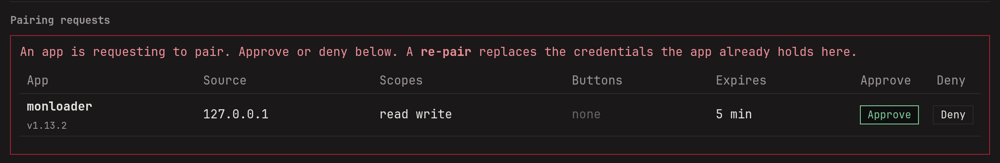
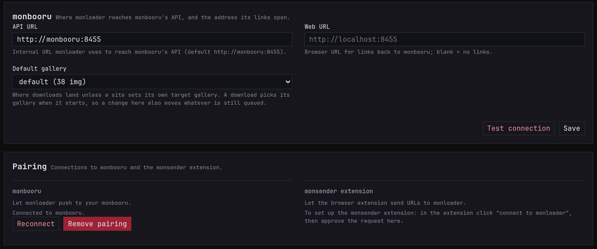

monloader sits in the middle, so it pairs twice: with monbooru, which
it sends downloads to, and with the monsender extension, which sends
URLs to it. Each link is approved once, and the two apps set up access
between themselves. [Pairing](../../../pairing.md) explains the idea;
this page is the monloader side.

## Pair with monbooru

1. In monloader's **Settings**, check the **API URL** under
   **monbooru**. The default, `http://monbooru:8455`, is right when
   both run from monbooru's compose file.
2. Under **Pairing**, click **Connect to monbooru**.
3. In monbooru, approve the request under **Settings -> Plugins**.

   

4. Back in monloader, pick the **Default gallery** downloads go to,
   and save.

   

monloader can then add images and tags to monbooru, but never delete
anything, and monbooru can ask monloader for lookups.

If the link breaks later, say after moving one of the apps, press
**Reconnect** and approve the new request in monbooru.

## Pair with monsender

1. In the extension's options, set monloader's address and click
   **connect to monloader** (see
   [monsender setup](../../../monsender/getting-started/setup/index.md)).
2. Approve the request in monloader under **Settings -> Pairing**.

## Pausing the link

The dot in monloader's footer turns green once monbooru is reachable.
Click it to hold the link: monloader refuses new downloads, from the
add bar and the extension alike, until you click it again. Jobs
already in the queue carry on; the queue's own
[pause](../../guides/downloading/index.md#pause-and-resume) holds
those. The pairing stays as it is, and monbooru's footer has the same
switch for the other direction.
