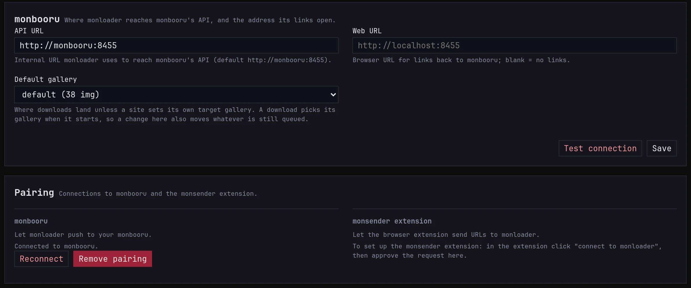

monloader sits in the middle, so it pairs twice: with monbooru, which
it sends downloads to, and with the monsender extension, which sends
URLs to it. Each link is approved once, and the two apps set up access
between themselves. [Pairing](../../../pairing.md) explains the idea;
this page is the monloader side.

## Pair with monbooru

1. In monloader's **Settings**, check the **API URL** under
   **Monbooru**. The default is right when both run from monbooru's
   compose file, or on the same computer for a desktop build.
2. Under **Pairing**, click **Connect to monbooru**.
3. In monbooru, approve the request under **Settings -> Plugins**.

   

4. Back in monloader, downloads go to monbooru's active gallery. To send
   them elsewhere, pick a **Default gallery** and click **Save**.

   

## Pair with monsender

The extension asks from its own options, and you approve the request
here under **Settings -> Pairing**, in the **Monsender extension**
block.
[monsender setup](../../../monsender/getting-started/setup/index.md)
has the steps.

## Pausing the link

The dot in monloader's footer turns green once monbooru is reachable.
Click it to hold the link: monloader refuses new downloads, from the
add bar and the extension alike, until you click it again. Jobs
already in the queue carry on; the queue's own
[pause](../../guides/downloading/index.md#pause-and-resume) holds
those. The pairing stays as it is, and monbooru's footer has the same
switch for the other direction.
