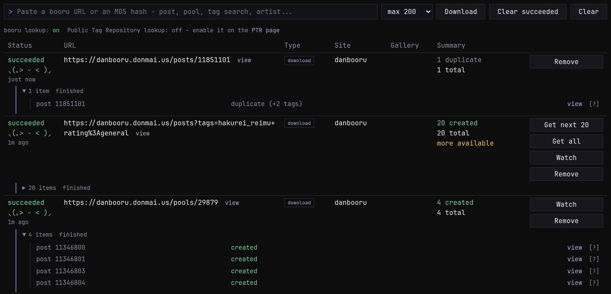

Paste a URL into the add bar and press Enter: a single post, a pool, a
tag search, an artist page, a manga, or a direct link to an image.
Anything gallery-dl understands works. You can also send pages
straight from your browser with the
[monsender extension](../../../monsender/guides/sending.md).

Each URL becomes a job on the queue. monloader works out which posts
it covers, downloads each one, [translates its tags](../mapping/index.md)
for monbooru and sends it to your gallery. Once monbooru has the file,
monloader deletes its own copy; it keeps nothing.

## Per-item outcomes

Every post in a job ends with one of these:

| Outcome | Means |
|---|---|
| `created` | a new image in monbooru |
| `duplicate` | monbooru already had this file; any new tags were added to it |
| `enriched` | a lookup or refresh added tags to an image monbooru already had |
| `matched` | a PTR lookup found the image's tags, and monbooru applied them |
| `replaced` | an [upgrade](../../../../guides/lookup/index.md#running-lookups-from-monbooru) swapped in a better file |
| `skipped_archive` | already downloaded before, so not again |
| `skipped_unsupported` | a file type monbooru doesn't take (audio, a document...) |
| `skipped_blacklist` | it matched one of your blacklist rules, named beside it |
| `failed` | something went wrong; the row says what |

A failed item also carries an error code; the list is in
[API and development](../../development.md#error-codes).

## Skipping posts by tag

You can skip posts that contain certain tags. List their tags under
**Global blacklist** in **Settings -> Tags**, one rule per line:
`guro` skips any post carrying that tag, `furry -rating:general` skips furry
posts unless they're rated general, and
`*_(cosplay)` uses a wildcard. A list for just one site should go on the site's
**mappings** tab.

## Big searches

A tag search or an artist page can run to thousands of posts, so a job takes at most 200 of them by default (**Settings -> Downloads**). To change it on the fly, use the menu beside the add bar; it remembers your last pick. A job that hit its limit offers **Get next N** for the next batch
and **Get all** for the rest. Pools and manga
are exempt: you asked for the whole thing, so you get all of it.

## Watching a search

Watch a tag search or an artist page and monloader checks it again on a
schedule, so new posts keep landing in monbooru without you pasting the
URL again. Click **Watch** on a finished search in the queue, or paste
the URL on the **Watched** page and pick how often to check it. 

## Retrying

- **Retry** runs a job again. Posts it already downloaded are skipped
  (`skipped_archive`), unless the job had failed.
- **Force download** fetches everything again, skipped posts included:
  the way to get back a post whose image you deleted in monbooru.
- Sending a **single post** again always fetches it again, and
  monbooru adds any new tags to the image it has. That's how to
  refresh one post.

Stopping or restarting monloader cancels the jobs that hadn't
finished. They stay in the list so you can retry them, and one that was
mid-download comes back marked **interrupted**, one click away from
being queued again. Finished jobs clear themselves after a few days;
the delays are in **Settings -> Downloads**.

When a download fails and you want to know why, the `[?]` next to a
finished item fetches that post again with gallery-dl's debug log on,
and shows you the log. Nothing is sent to monbooru.

## Pause and resume

The **pause** button in the top bar (also in the monsender popup)
holds all downloads: the one in progress finishes, then nothing new
starts until you resume. Handy to line up a batch before letting it
run. A restart un-pauses.

## Pools and manga

- A **booru pool** comes in as a
  [collection](../../../../guides/collections/index.md): each page is
  its own image with its own tags, in order.
- A **manga or comic** is bundled into one `.cbz` archive, which
  monbooru opens in its reader. If any page fails to download, the job
  fails rather than sending half a book.
- A **manga title** with chapters becomes one archive per chapter.

Some pages only link to files hosted elsewhere, like a forum thread.
monloader follows those links and downloads what they point to.

## Tagging by hash

Paste a file's md5 (on its own or as `md5:<hash>`) into the add bar
and monloader imports the booru post that has that file, like any
single post. It uses the same [lookup chain](../lookup/index.md) that
monbooru's lookups use.
