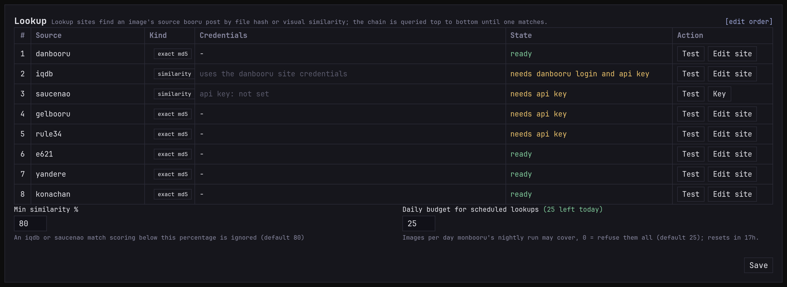

Reverse lookup starts from a file instead of a URL: "where does this
picture come from, and what are its tags?" monloader asks a list of
sources in turn, the lookup chain, and brings back the first answer.

Most lookups come from monbooru, when you look up an image you already
have (see [monbooru's lookup guide](../../../../guides/lookup/index.md)).
You can also paste a file's md5 into monloader's add bar to import the
post that has it. Either way, each lookup shows up on the queue page
like a download.

## The lookup chain

The chain is asked top to bottom, and the first source with an answer
wins. There are two kinds of source:

- **An md5 search on a booru.** Exact, but it only finds the original
  file: a resized or re-saved copy has a different hash and misses.
- **A similarity service**, IQDB or SauceNAO. These compare what the
  picture looks like, so they find re-saved copies too, and answer
  with candidates and a match score. The best candidate at or above
  the **min similarity** (80% by default) is then downloaded like any
  post.

The **lookup** section of the Settings page is where you choose which
sources are asked, in what order, and the minimum similarity. Each row
has a test button. A source that's down or refuses is skipped and the
chain carries on.

A pasted md5 has no picture to compare, so it only goes to the md5
searches.

## Credentials

A source that's missing its credentials is skipped, so it costs
nothing until you set it up.

- **IQDB** uses your danbooru login (username and API key, from the
  danbooru row in [sites](../sites/index.md)). Danbooru only lets
  accounts of Member level or above, with a verified email, use it.
- **SauceNAO** needs its own API key, free from saucenao.com. The free
  tier allows about 100 searches a day. Enter it with the **key** button
  in the lookup section.
- The md5 searches use each site's usual login: gelbooru and rule34,
  for instance, need their API key.

## When a lookup finds nothing, or only half

Sometimes a similarity service points at a post that can't be
downloaded, because it was deleted or needs a login you haven't set
up. The match is still recorded as the image's source, without tags,
and the queue marks it `source only`. The same goes for a confident
match on a site monloader can't download from, like a pixiv page.

When nothing has the file, the item ends `hash_not_found` and lists
every source it asked and why each missed, including the closest
similarity candidates and their scores. If good matches keep falling
just short, lower the minimum similarity.

## The PTR

With the [Hydrus PTR](../ptr/index.md) turned on, monloader can also
answer from its local copy of the PTR, which knows files that were
never on a booru or were deleted since. monbooru asks it separately
from the chain.

## Nightly lookups from monbooru

monbooru's nightly run can look up the images that have no source yet
(see [Looking up a library overnight](../../../../guides/lookup/index.md#looking-up-a-library-overnight)).
monloader sets how far it goes: the **daily budget** in **Settings ->
lookup** is how many images a night it accepts, 25 by default. Once
it's spent, monbooru stops and picks up where it left off the next
night. These lookups wait behind everything else, so they never hold
up a URL you paste. Lookups you start by hand in monbooru don't count
against the budget.
