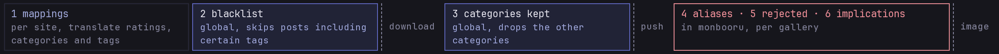
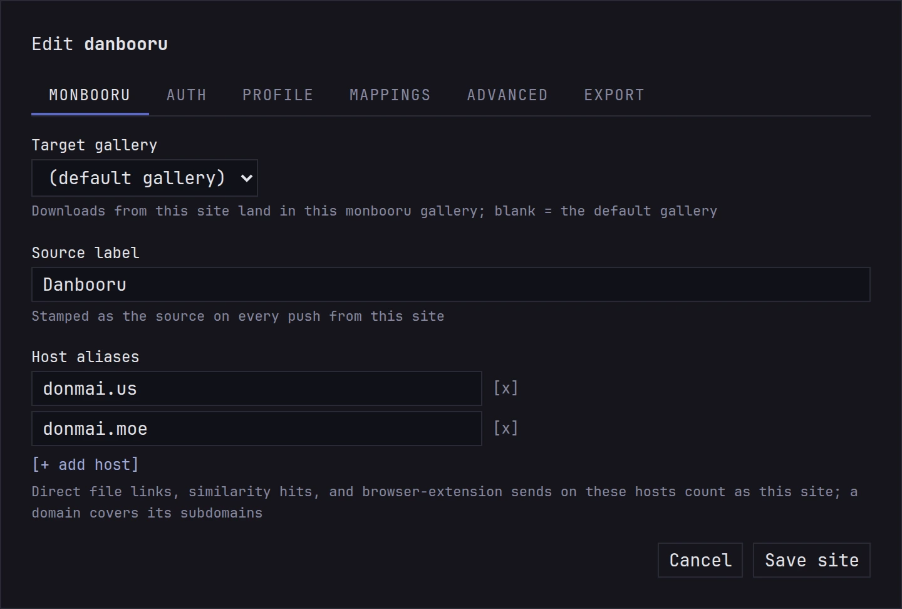
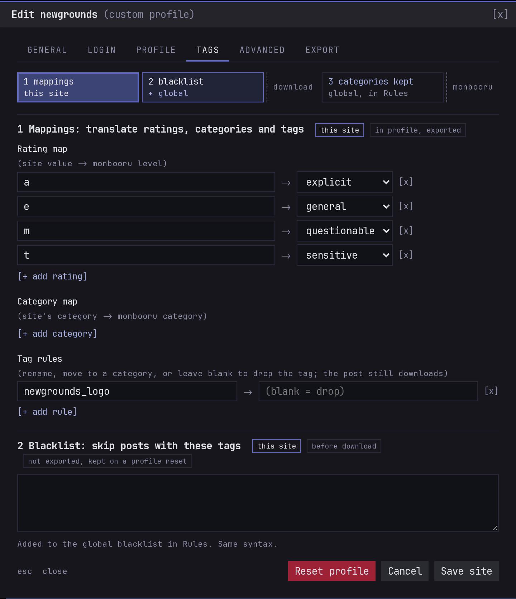

Each site has its own tag categories and rating letters. monloader
translates them into monbooru's, so a site's `circle` tags land in
`artist` and its `parody` tags in `copyright`. It uses a profile per
site (the shipped ones, with your edits on top) and a generic fallback
for the rest.

## The three steps

A post goes through three steps on its way to monbooru, shown at the
top of **Settings -> Rules**:

1. **Mappings** translate the site's ratings, categories and tags into
   monbooru's. Each site has its own, see
   [editing a site's profile](#editing-a-sites-profile).
2. **Blacklist** skips the whole post before anything downloads. One
   list covers every site and a site can add its own, see
   [skipping posts by tag](../downloading/index.md#skipping-posts-by-tag).
3. **Categories kept** drops the tags of the categories you unchecked,
   on every site. The post still downloads.

Tags from the Public Tag Repository go through the same steps, see
[the PTR's mappings and blacklist](../ptr/index.md#its-mappings-and-blacklist).

## Tags

A booru's tag categories land in the monbooru category with the same
name (general, artist, character, copyright, meta, species). The rest
go to the closest match:

| Site category | monbooru category |
|---|---|
| metadata, lore, faults | meta |
| contributor, circle, group | artist |
| parody, series, studio | copyright |
| model | person |
| invalid, deprecated | dropped |
| anything else | general |

If you only want some categories at all, say characters and copyrights,
uncheck the others under **Keep tags from these categories** in
**Settings -> Rules**.

## Ratings

The full words (general, sensitive, questionable, explicit, and safe,
which becomes general) mean the same everywhere. The trap is the letter
`s`: on Danbooru it means "sensitive", everywhere else it means
"safe". monloader knows which kind of site each one is and reads it
accordingly. A rating it doesn't recognize leaves the image unrated.

Manga sites rarely rate their galleries, so the profiles of
adult-only sites (nhentai, hitomi, exhentai and the like) rate their
downloads explicit unless the site says otherwise.

## Sources

Each image gets its post's page as its source, labelled with the
site's name, so `source:danbooru` finds everything from danbooru.

Booru posts also bring the artist's commentary, the original upload
they point to (a pixiv or twitter page, say), and any note boxes drawn
on the image; see [Sources and notes](../../../../guides/provenance/index.md).
A post that names a parent post is linked to it in monbooru once both
are there.

## One label per site

The same site can show up under several names: `danbooru` from its
posts, `cdn.donmai.us` from a direct link to one of its files. To keep
them under one source in monbooru, a site's settings have two fields:

- **Source label** is the name its downloads are filed under. Empty
  keeps the site's own name.
- **Extra hosts** are the other addresses that belong to it: file
  servers, mirrors. A file from one of them counts as the site.

For a host that isn't any site gallery-dl knows (a wiki you save
images from, say), give it a label under **Host labels**, below the
sites tables. Labels only apply to new downloads.

## Editing a site's profile

When a site's tags or ratings come out wrong, fix them on the
**profile** and **tags** tabs of its settings. Changes apply to the
next download.

- **Family** decides how ratings and tag categories are read. Most
  sites that aren't boorus use `generic`. **Kind** says whether a
  gallery is a manga, bundled into one archive.
- The **Rating map** fixes a site whose letters read wrong: a site that
  uses `e` for "everyone" would otherwise come out explicit.
- The **Category map** sends one of the site's tag categories to a
  different monbooru category, your own included, or drops it.
- **Tag rules** fix single tags: rename a misspelled one, move it to
  another category, your own or general included, with a `category:` prefix, or
  leave the replacement empty to drop it.
- Setting the **MD5 search template** lets the site take part in
  [reverse lookup](../lookup/index.md).

The **export** tab gives you your profile, ready to share. If a fix is
worth having for everyone, see
[site profiles](../../development.md#site-profiles).

## What applies when

A tag passes through monloader's rules on its way out, then through the
gallery's own on arrival. Each step lives where it applies.

| To... | Use | Applies to |
|---|---|---|
| skip posts with a tag | **Blacklist** in **Settings -> Rules** | every site |
| skip them from one site only | the site's **Blacklist** | that site |
| keep the posts, drop a whole category | **Keep tags from these categories** | every site |
| the same, on one site | **Category map**, set to drop | that site |
| keep the posts, drop one tag | **Tag rules**, empty replacement | that site |
| rename a tag or move it to another category | **Tag rules** | that site |
| drop a label one auto-tagger keeps getting wrong | **Configure -> mappings** on the tagger, in monbooru | that tagger |
| keep a name out of the gallery, whatever brings it | **Reject tags** on monbooru's Tags page | the gallery |
| rename a tag for everyone, whatever brings it | an **alias** on monbooru's Tags page | the gallery |

A blacklist rule reads every tag the post lists, including the ones you drop,
so a post can be skipped for a tag you'd never have kept. The flow strip at
the top of **Settings -> Rules** shows the whole path, and a tag's own page in
monbooru draws it for that one name (see
[Cleaning up tags](../../../../guides/tag-cleanup/index.md#rejected-names)).

## Tracing a post

To see what these steps would do to a post, paste its URL under
**Settings -> Trace a post**. You get one line per tag, showing what
each step did to it and what monbooru would receive. Nothing is
downloaded.
