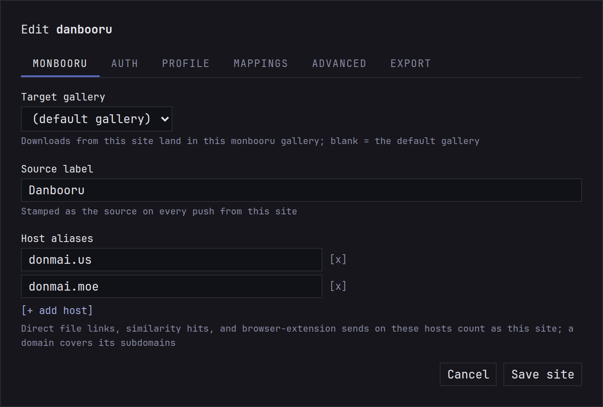
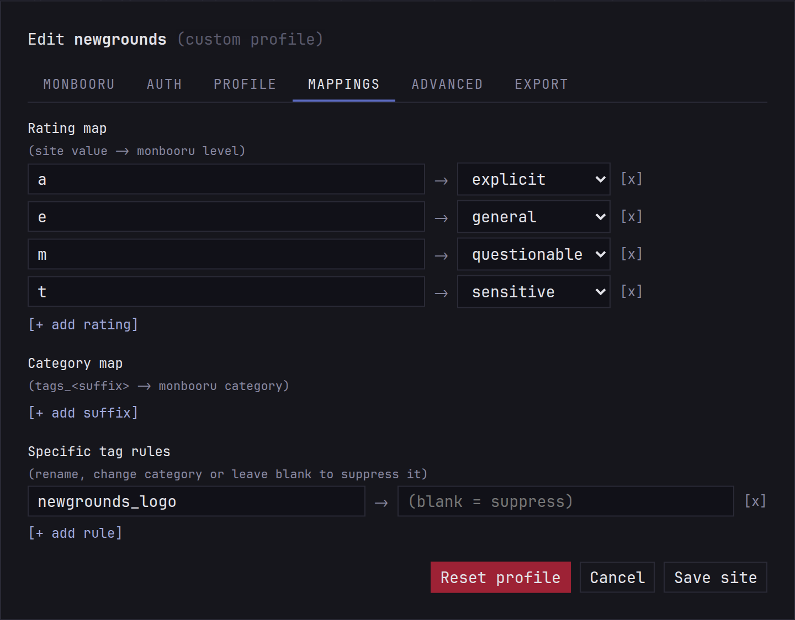

Every site describes its posts its own way: its own tag categories,
its own rating letters, its own URLs. monloader translates all of that
into what monbooru expects, using a profile per site (the shipped
ones, with your edits on top) and a generic fallback for the rest.

## Tags

A booru's tag categories land in the monbooru category with the same
name (general, artist, character, copyright, meta, species). The rest
go to the closest match:

| Site category | monbooru category |
|---|---|
| metadata, lore, faults | meta |
| contributor, circle, group | artist |
| parody, series, studio | copyright |
| model | person |
| invalid, deprecated | dropped |
| anything else | general |

Tag names are brought into monbooru's form on the way: lowercase, with
spaces turned into underscores (`fate/grand order` becomes
`fate/grand_order`).

If you only want some categories at all, say characters and copyrights,
uncheck the others under **Settings -> Tags**. That applies to every site,
after everything above.

## Ratings

The full words (general, sensitive, questionable, explicit, and safe,
which becomes general) mean the same everywhere. The trap is the letter
`s`: on Danbooru it means "sensitive", everywhere else it means
"safe". monloader knows which kind of site each one is and reads it
accordingly. A rating it doesn't recognize leaves the image unrated.

Manga sites usually don't rate their galleries at all, which would let
them through a safe-for-work ceiling. So the profiles of adult-only
sites (nhentai, hitomi, exhentai and the like) rate their downloads
`explicit` whenever the site doesn't say otherwise.

## Sources

Each image gets its post's page as its source, labelled with the
site's name, so `source:danbooru` finds everything from danbooru. A
direct link to a file has no post page, so its source is the file's
own address; when monsender sends a file along with the page you found
it on, that page is used instead.

Booru posts also bring the artist's commentary, the original upload
they point to (a pixiv or twitter page, say), and any note boxes drawn
on the image; see [Sources and notes](../../../../guides/provenance/index.md).
A post that names a parent post is linked to it in monbooru once both
are there.

## One label per site

The same site can show up under several names: `danbooru` from its
posts, `cdn.donmai.us` from a direct link to one of its files. To keep
them under one source in monbooru, a site's settings have two fields:

- **Source label** is the name its downloads are filed under. Empty
  keeps the site's own name.
- **Host aliases** are the other addresses that belong to it: file
  servers, mirrors. A file from one of them counts as the site.
  monsender uses the same list to recognize the site on a mirror.

For a host that isn't any site gallery-dl knows (a wiki you save
images from, say), give it a label under **Host labels**, below the
sites tables. Labels only apply to new downloads.

## Editing a site's profile

When a site's tags or ratings come out wrong, fix them on the
**profile** and **mappings** tabs of its settings. Changes apply to the
next download.

- **Family** decides how ratings and tag categories are read. Most
  sites that aren't boorus use `generic`. **Kind** says whether a
  gallery is a manga, bundled into one archive.
- The **Rating map** fixes a site whose letters read wrong: a site that
  uses `e` for "everyone" would otherwise come out explicit.
- The **Category map** sends one of the site's tag categories to a
  different monbooru category, your own included, or drops it.
- **Tag rules** fix single tags: rename a misspelled one, move it to
  another category, your own included, with a `category:` prefix, or
  leave the replacement empty to drop it.
- Setting the **MD5 search** URL lets the site take part in
  [reverse lookup](../lookup/index.md).

Your profile is saved as one file, and the **export** tab gives it to
you ready to share. If a fix is worth having for everyone, see
[site profiles](../../development.md#site-profiles).

## What applies when

Every post goes through the same steps, in this order, and **Settings -> Tags**
and each site's **mappings** tab show them as a strip: the site's maps, its tag
rules, the blacklists, the download, then **Categories sent**. A blacklist skips
the whole post, and everything else only drops or moves tags.

| You want to... | Use | Applies to |
|---|---|---|
| never fetch posts with a tag | **Global blacklist** | every site |
| never fetch them from one site | the site's **Blacklist** | that site |
| keep the posts, lose a whole category | **Categories sent** | every site |
| the same, on one site | **Category map**, set to drop | that site |
| keep the posts, lose one tag | **Tag rules**, empty replacement | that site |
| rename a tag or move it to another category | **Tag rules** | that site |

A blacklist rule reads every tag the post lists, including the ones you drop,
so a post can be skipped for a tag you'd never have kept.

## Tracing a post

To see what these steps would do, paste a post URL under **Trace a post**, in
**Settings -> Tags** or on a site's **mappings** tab. You get one line per tag,
showing what each step did to it and what monbooru would receive, or which rule
would skip the post. Nothing is downloaded, and a trace uses your saved settings,
so save your edits first. A search or a pool traces its first post.
