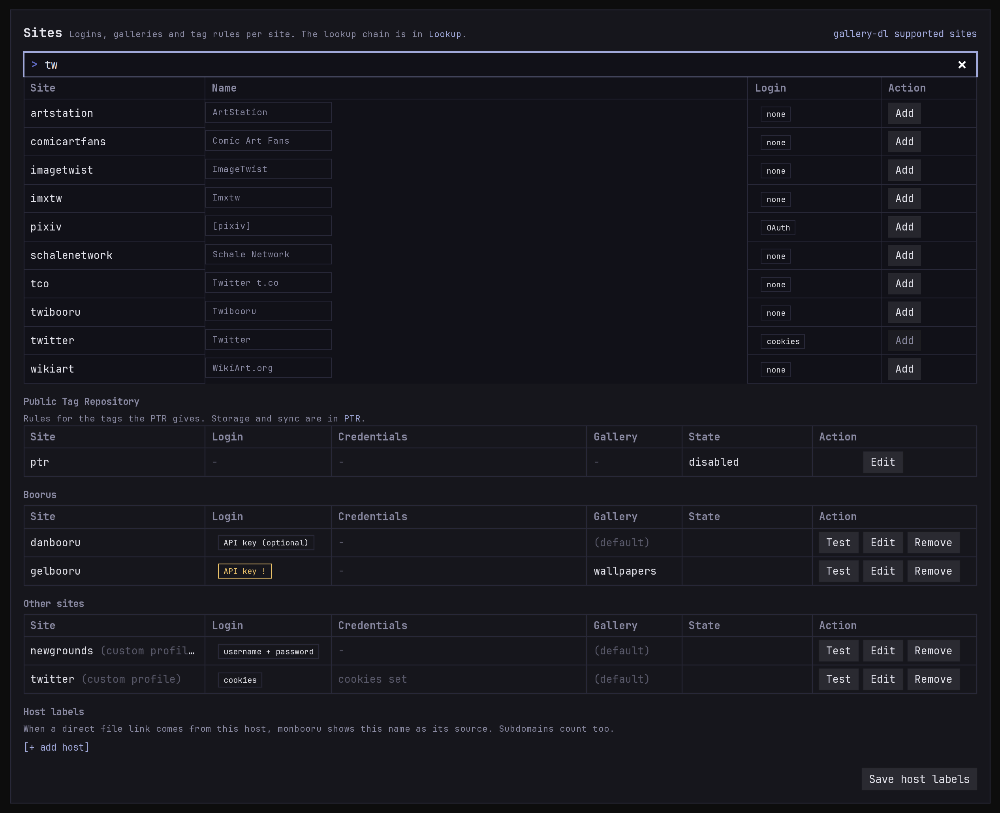
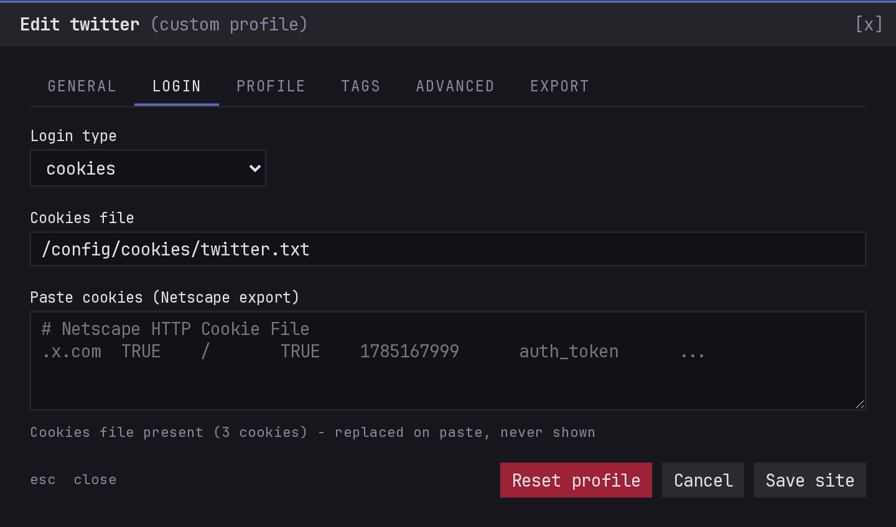

monloader works with every site gallery-dl supports, out of the box
(see [gallery-dl's list](https://github.com/mikf/gallery-dl/blob/master/docs/supportedsites.md)).
It ships tuned profiles for the popular boorus and falls back to a
generic one for everything else. You only need to set a site up when
it wants a login, when you want its downloads in a particular gallery,
or when its tags need fixing.

## The sites tables

The sites tables in **Settings** list the sites you've set up, not the
sites that work, so they start short. Add a site with the search box
above them.

The **Login** column says what a site needs, and flags a site that's
missing it:

| Login | Means | For example |
|---|---|---|
| `none` | nothing needed | most boorus and manga sites |
| `API key (optional)` | works without a key, faster with one | danbooru |
| `API key` | won't work without an API key | gelbooru, rule34 |
| `username + password` | your account name and password | newgrounds |
| `cookies` | a logged-in browser session (see below) | twitter, sankaku, exhentai |
| `OAuth` | gallery-dl's own login flow, run once | pixiv, reddit, deviantart |

Danbooru also wants your **User ID**, the number on your profile page:
monloader names your account with it in every request, and Danbooru can
block requests that don't.

For a site monloader has no profile for, the login type is a guess
from gallery-dl's data. If it's wrong, fix it on the site's
**profile** tab.

## Setting up a site

**Edit** on a site's row opens its settings. There you can:

- send the site's downloads to a particular **gallery** instead of the
  default one;
- enter its **credentials**, which are never shown back once saved;
- fix how its tags and ratings are read, on the **profile** and
  **tags** tabs (see [Metadata mapping](../mapping/index.md#editing-a-sites-profile));
- set the **user agent** its requests send, on the **advanced** tab: any
  text, or the gallery-dl preset `+firefox`, `+chrome` or `+gallery-dl`;
- add extra [gallery-dl options](https://gdl-org.github.io/docs/configuration.html)
  for anything monloader has no field for.

**Test** tries the site with your credentials and tells you whether it
works, needs a login, or is blocked by a captcha.

## Cookies

Some sites only work with a logged-in session. Log in with your
browser, export the site's cookies in the `cookies.txt` format (a
browser extension can do it), and paste them into **Paste cookies** on
the site's **login** tab. When the session expires, export and paste
again.

The same settings can be written in `monloader.toml`; see
[Configuration](../../configuration.md).
