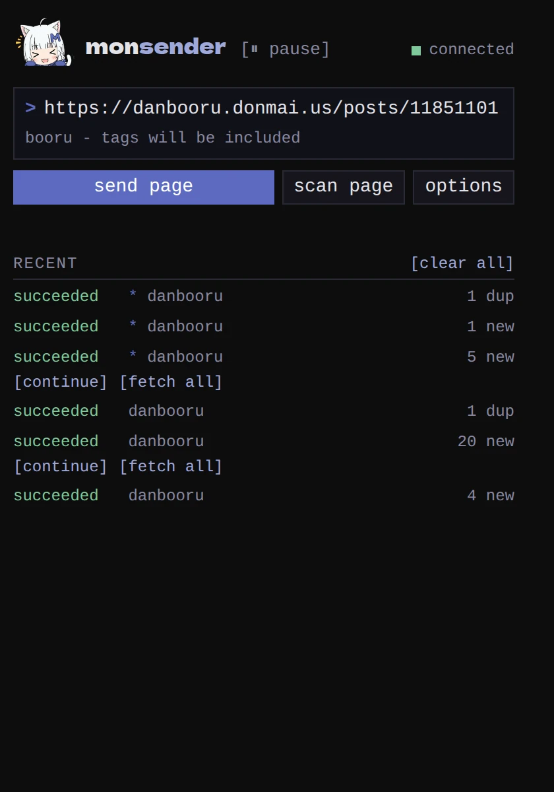

monsender is a browser extension for Firefox and Chrome that sends
things to your [monloader](../monloader/_index.md) download queue:

- the page you're looking at, with one click or a keyboard shortcut;
- an image or video you right-click;
- images you pick after scanning a page.

monloader then downloads them into monbooru. Send a post page from a
booru and the image arrives with its tags; send a bare image file and
it arrives without. [Sending](guides/sending.md) explains the
difference.

The extension only ever sends to your monloader, and monloader does
the downloading. The one thing your browser loads from elsewhere is
the thumbnails of a page scan, which you can
[turn off](guides/scanning/index.md#previews).

To get going, [install it](getting-started/install.md) and
[pair it with monloader](getting-started/setup/index.md).
