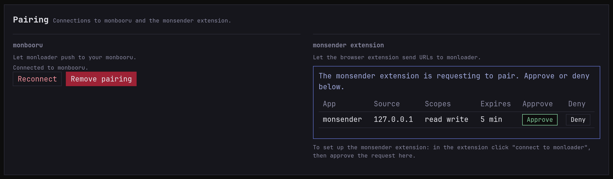
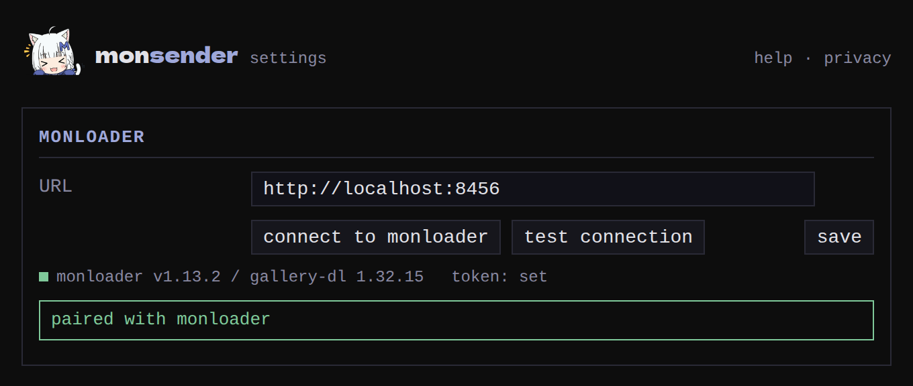

Setup is two steps: tell the extension where monloader is, then pair
the two.

## 1. Set the monloader URL

In the extension's options, enter the address your browser reaches
monloader at, the way you'd type it in the address bar:
`http://localhost:8456` on the same machine, or something like
`http://192.168.1.20:8456` on your network. Plain `http://` is fine at
home.

## 2. Connect to monloader

Click **connect to monloader**. Then open monloader in another tab, go
to **Settings -> Pairing**, and approve the request in the **monsender
extension** block.

If it gave up waiting before you approved, click **connect to
monloader** again and approve the new request.

## Check it worked

Click **test connection**. A green dot with the monloader and
gallery-dl versions means you're set. Anything else is covered in
[troubleshooting](../../troubleshooting.md).

## If you change the URL later

Saving a different URL forgets the extension's key, so it's never sent
to another server. Click **connect to monloader** again to pair with
the new address.

Next: [sending pages and images](../../guides/sending.md).
