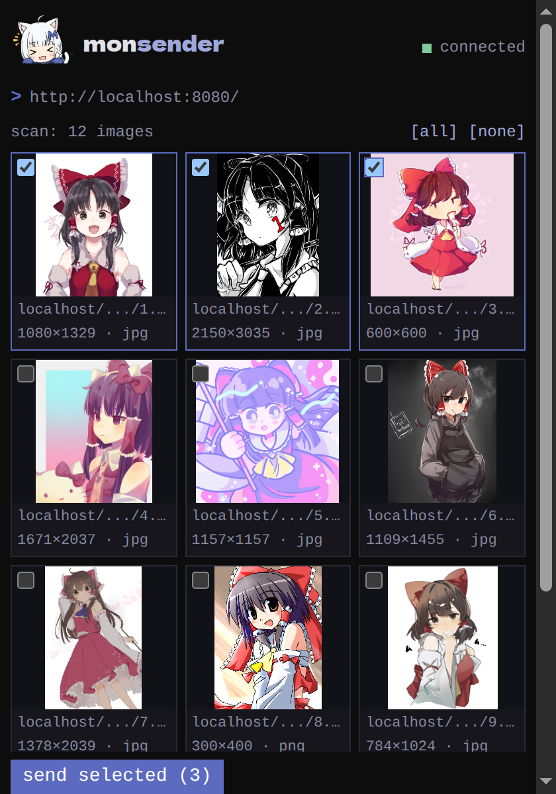

Some pages hold lots of images and aren't a booru post: a forum
thread, a blog post, an image dump. Scan the page and pick the ones
you want.

Open the popup and click **scan page**. The chooser opens beside the
page (Chrome's side panel, Firefox's sidebar), so you can scroll the
page while you pick. Tick what you want and send.

Nearly everything a scan finds is a direct image file, so scanned
images arrive in monbooru without tags (see
[tagged or untagged](../sending.md#tagged-or-untagged-what-arrives)).

## What the chooser lists

- Only what monbooru can store: JPEG, PNG, GIF, WebP, AVIF and JPEG XL
  images, and MP4 and WebM videos.
- Nothing smaller than the **min image size** (64 pixels by default),
  which keeps out icons and buttons.
- At most the **scan cap** (100 by default). When a page holds more,
  the header says so: "scan: 100 of 350 images".

Both are in [settings](../../settings/index.md).

When the page offers an image in several sizes, its card shows one
button per size ("1500w", "800w"). The largest is picked for you.

If some picks fail to send, the chooser says why and keeps your
selection, so you can send again once it's fixed. Sending the ones
that made it a second time is harmless: they come back as duplicates.

## Previews

The thumbnails load straight from wherever the images live. If you'd
rather the chooser contact no other server at all, turn **previews**
off in [settings](../../settings/index.md): cards then show the file
name instead, and picking works the same.

A tile marked "preview failed" couldn't be shown, usually because the
site refuses to serve its images elsewhere. You can still send it;
the outcome in the queue tells you whether monloader could fetch it.
