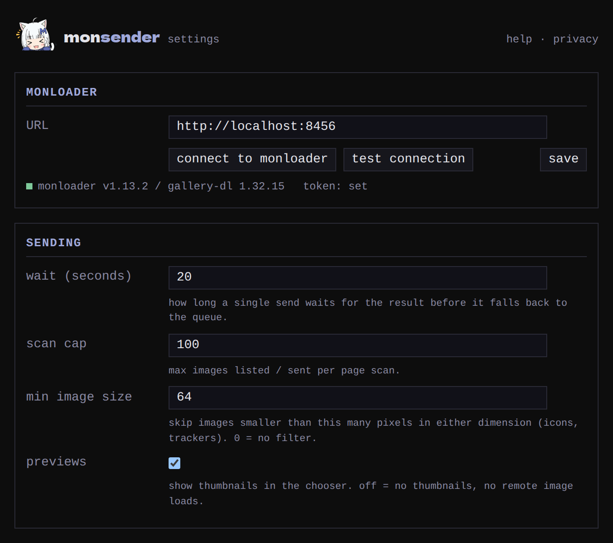

Open the popup and click **options**, or right-click the toolbar icon
and open the extension's options. Settings are kept in this browser
only.

- **URL**: the address your browser reaches monloader at. Saving a
  different one forgets the pairing, so you'll
  [connect again](../getting-started/setup/index.md#if-you-change-the-url-later).
- **wait (seconds)**: how long a send waits to show you its outcome
  before handing over to the queue. 20 by default; 0 doesn't wait at
  all.
- **scan cap**: the most images a [page scan](../guides/scanning/index.md)
  lists. 100 by default.
- **min image size**: a scan skips images smaller than this many
  pixels, which leaves out icons and buttons. 64 by default; 0 keeps
  everything.
- **previews**: thumbnails in the scan chooser. Turn them off and the
  chooser loads nothing from other servers; see
  [previews](../guides/scanning/index.md#previews).
