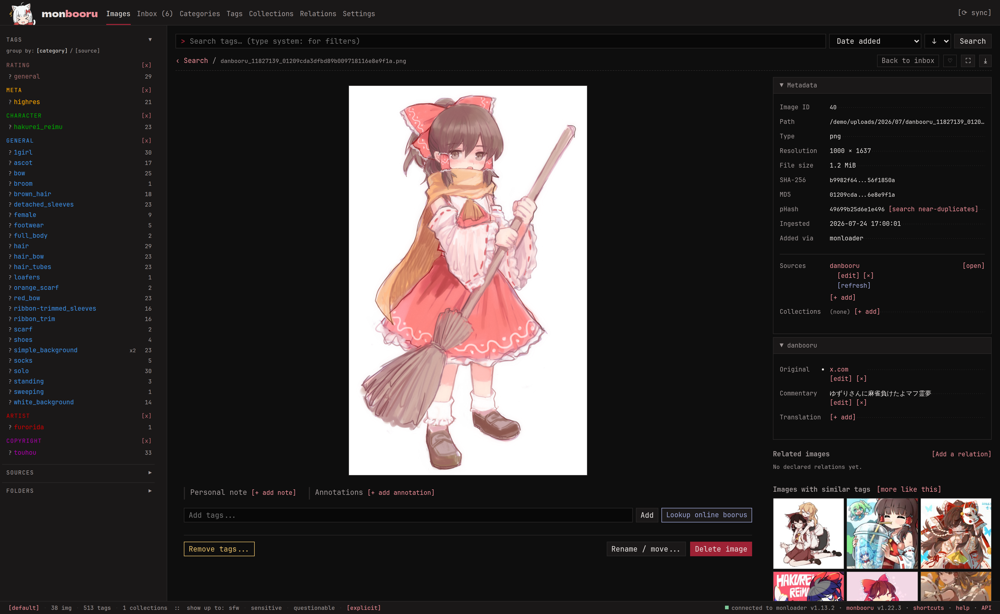
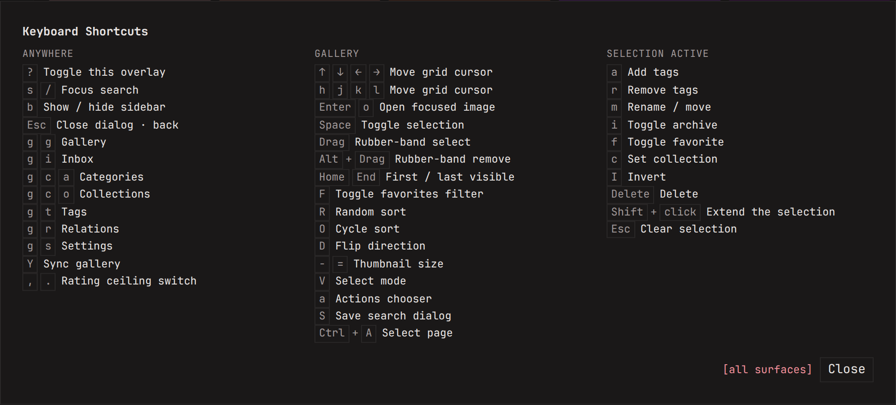

Now you have monbooru running and an empty gallery. This page walks
through the basic loop once with a handful of images: add them, tag
them, find them again, and file them away.

## Add a few images

There are two ways in:

- **Copy files into the gallery folder**, the one you picked during
  setup (on Docker, whatever you mounted at `/gallery`). monbooru
  notices new files within seconds. Files that were already there
  before it started are picked up by a sync: press the sync button at
  the top right. Subfolders are fine, and show up as a folder tree in
  the sidebar.
- **Upload from the browser**: open **Inbox** in the top menu and drop
  files on the drop zone at the top.

monbooru takes JPEG, PNG, WebP, AVIF, JPEG XL, GIF, MP4, WebM, and
CBZ/ZIP comic archives. A file you add twice, even under two
different names, is recognized and kept once.

New images land in the [inbox](../../guides/inbox/index.md), the pile
of things you haven't looked at yet.

## Tag one

Click a thumbnail to open its page.

Type a few tags into the tag box, separated by spaces: what's in the
picture (`red_hair`, `beach`), who made it (`artist:"john doe"`),
anything you'll want to search for later. Add a rating too, from
`rating:general` to `rating:explicit`, to say how safe the image is to
have on screen. [Tags](../../guides/tags/index.md) explains categories
and ratings.

If typing tags for a whole collection sounds like a lot, the
[auto-tagger](../../guides/auto-tagger/index.md) can do a first pass
for you.

## Find it again

Type into the search bar: `red_hair -sketch rating:general` finds
images tagged `red_hair`, not tagged `sketch`, and rated general.
[Searching](../../guides/searching/index.md) has the rest of the
syntax.

Click anything in the sidebar (a tag, a folder, a saved search) to
narrow the search. Tick thumbnails and a batch bar appears, with
actions for everything you ticked or for the whole search.

The rating buttons in the footer are the SFW ceiling: click a level to
hide everything rated above it.

## File it away

Once an image's tags and rating look right, move it from the inbox to
the archive: press `i` on its page, or tick a batch of thumbnails and
do it from the batch bar.

## Help inside the app

Type `system:` in the search bar for a list of every search filter,
with hints for each.

Press `?` on any page for the keyboard shortcuts that work
there. Nearly everything can be done from the keyboard.

## Where next

- [Searching](../../guides/searching/index.md) and
  [Tags](../../guides/tags/index.md) cover the loop above in depth.
- [Galleries](../../guides/galleries/index.md) if you want a second,
  separate library, say wallpapers apart from art.
- The [addons](../../addons/_index.md) add downloading from boorus and
  reverse image lookup.
