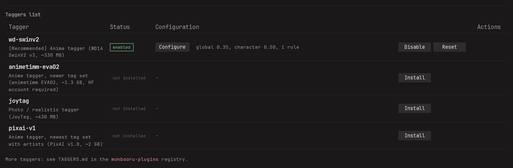
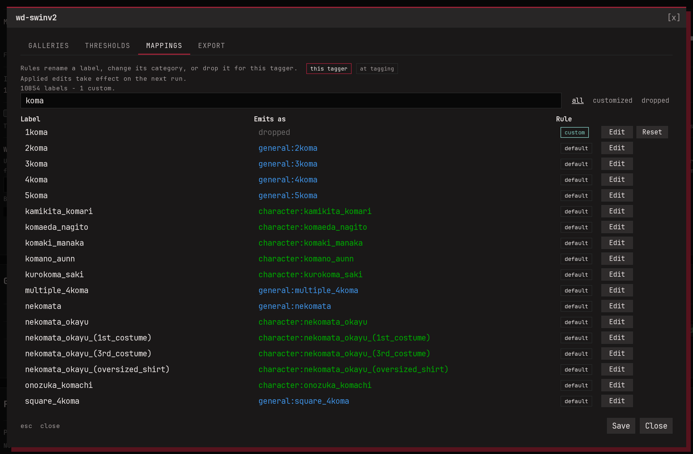

The auto-tagger runs an image-tagging model on your own CPU or GPU. It
looks at each picture and adds the tags it recognizes: `1girl`,
`red_hair`, `outdoors`, a character it knows, a rating. Nothing is
sent anywhere. It's off until you install a model.

Auto-tags are kept apart from yours. They remember which model added
them, and you can strip one model's tags later without touching
anything you typed.

## Installing a model

Open **Settings -> Auto-Tagger** and press **Install** on one of the
suggested models. The dialog tells you which files to download and
where to put them, or gives you a command that fetches them. Reload
the page once the files are in place: the model is switched on as soon
as monbooru finds them.

More models are listed in the monbooru-plugins registry: copy a
model's folder into the models folder. Other ONNX tagging models can work as well; see
[Auto-tagger: GPU and models](../../advanced/auto-tagger.md).

## Tuning it

**Configure** on a model's row opens its settings.

**Galleries.** Which galleries the model runs on. Handy when one
gallery holds anime art and another your photos: an anime-trained
model has nothing useful to say about your holiday pictures.

**Thresholds.** A model gives each tag a confidence score, and tags
below the threshold are dropped. You can set it per category: raise
`character` to 0.85 and you get fewer wrong character guesses while
`general` stays generous. **Max tags** caps how many tags of a
category one image can get, and unticking a category stops the model
from producing it at all.

**Mappings.** Every label the model knows, and the tag it turns into.
Change a label's category, rename it, or drop it when the model keeps
getting it wrong. Changes apply from the next run.

When several models are enabled, they all run and their results are
merged, so a tag two models agree on is added once.

## Running it

- **One image:** the **Auto-tag** button next to the tag editor.
- **A selection or a whole search:** pick **Auto-tag** in the gallery's
  batch bar. To catch up on everything no model has seen yet, search
  `autotagged:false` first.
- **Every night:** tick **Run enabled auto-taggers** in
  **Settings -> Schedule** (see [Maintenance](../maintenance.md#nightly-schedule)).

If you cancel a batch run, whatever it already tagged stays tagged.

## Videos and archives

A video is tagged from a handful of frames and a comic archive from
its pages, and the results are merged into one set of tags for the
whole thing. A tag has to show up on several frames or pages to
stick, so one odd page doesn't tag the whole book.
