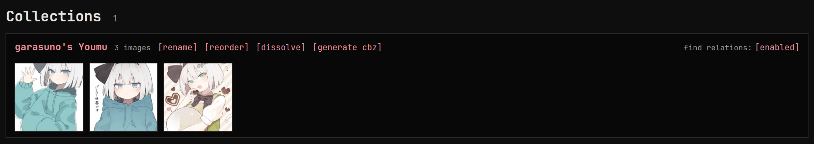

A collection is a named set of images, in an order if you want one: a
comic told in loose pages, a photo shoot, an artist's series. It's a
lighter link than a [relation](../relations/index.md), with no
original and no direction. An image can be in several collections,
with its own place in each.

## Filing images

Add an image to a collection from the **Collections** row on its page;
a new name creates a new collection. To file many images at once, tick
them and use **Collection** in the batch bar.

## The Collections page

On the Collections page, renaming a collection to the name of another
merges the two, the incoming pages going after the last page of the
other. Dissolving a collection removes the grouping and keeps the
images.

The near-duplicate finder leaves pairs from the same collection alone,
since the collection already says they belong together. The **find
relations** switch on a collection lets it look at them anyway.

To see a collection in the gallery, search `collection:"name"`: its
images come up in the collection's own order.

## Turning a collection into an archive

**[generate cbz]** on the Collections page packs a collection into a
CBZ archive, in collection order, which you can then read like any
other [comic archive](../manga/index.md). Handy when a set was
downloaded as loose images but reads as one book. The archive lands
in your upload folder, and the collection and its images stay as they
were.

Only still images can go in an archive, so a collection holding a
video or an animation can't be packed. To send a collection to someone
instead, download it as a zip; see
[Galleries](../galleries/index.md#download).

To unpack an archive into a collection, see
[Manga and comic archives](../manga/index.md#turning-an-archive-into-a-collection).
