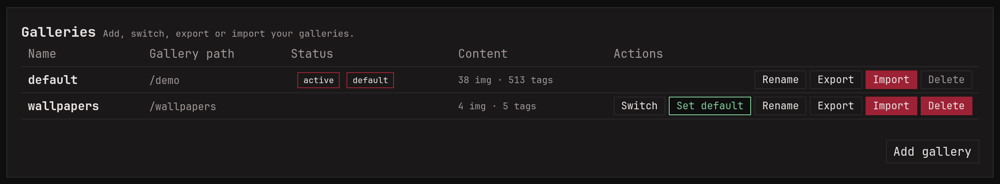

A gallery is a folder of images with its own database: its own tags,
saved searches, collections and relations. This is useful if you want images and tags to be completely separated, say art in one and family
photos in another, and switch between them from the footer.

Galleries are managed under **Settings -> Galleries**. Adding one takes
a name and a folder (on Docker, a folder you mounted into the
container). You can also start a gallery from an export file, which
fills it in one step.

Switching galleries switches for everyone using this monbooru, not
just your browser, and the default gallery comes back after a restart.

## What a gallery indexes

Everything under the gallery's folder, subfolders included.
Symlinked folders are followed too, so a gallery can pull in folders
from another drive without moving anything.

A gallery inside another gallery's folder keeps that folder to
itself: the outer gallery stops indexing it.

**Settings -> General -> Ignored files and folders** lists what no
gallery should index. It starts with the clutter NAS boxes, trash bins
and snapshot tools leave behind (`@eaDir`, `#recycle`, `.Trash-*`...).
A plain name is ignored wherever it appears (`.*` ignores every hidden
file and folder), and a path with a `/` counts from the top of the
gallery (`photos/raw` is just that one folder). Images the list newly
covers are marked missing on the next sync, never deleted.

**Delete** removes the gallery's database and thumbnails and leaves
your files alone, unless you also tick the option to delete its
folder.

## Export

Each gallery can be exported in three formats:

- **db**: a snapshot of the gallery's database. The one to pick for a
  backup.
- **json**: the same content as one readable JSON file.
- **light**: a `tags.json` listing each image's hash, path and tags,
  and nothing else. Handy as a tags-only backup or to feed other
  software.

Tick **with images** to get a `.zip` holding the export and every file
in the gallery. Thumbnails are left out; they're rebuilt on import.

## Import

**Import** takes anything Export made, or an export from another
application (see [Migrating](../migrating.md)). There are two modes:

- **Merge** adds what the upload has to the gallery. Images are
  matched by their content, so tags from the upload land on the images
  you already have. A `.db` or `.json` on its own brings tags only; new
  images come from a `.zip` that includes files.
- **Replace** wipes the gallery and loads the upload in its place,
  files included when the upload has them. You type the gallery's name
  to confirm.

Entries whose file isn't on disk still come in, tagged and marked
missing; `missing:true` finds them.

## Transfer

To send a few images to another gallery without exporting anything,
use **Transfer**, on an image's page or in the batch bar. The image is
copied over with its tags, rating, sources, notes and favorite, and
lands in the other gallery's inbox. If that gallery already has the
same file, the two are merged instead. Relations and collections stay
behind, since they point at images the other gallery may not have.
Tick **Remove from this gallery after transfer** to move rather than
copy.

## Download

To hand a set of images to someone, select them (or take the whole
search) and use **Download** in the batch bar, or press `d`. Your
browser saves one `.zip` of the original files, exactly as they are.

**Include tags** adds a `tags.json` in the light export's format.
Another monbooru can apply those tags to the same files: put the files
in its gallery, sync, then import the `tags.json`.
