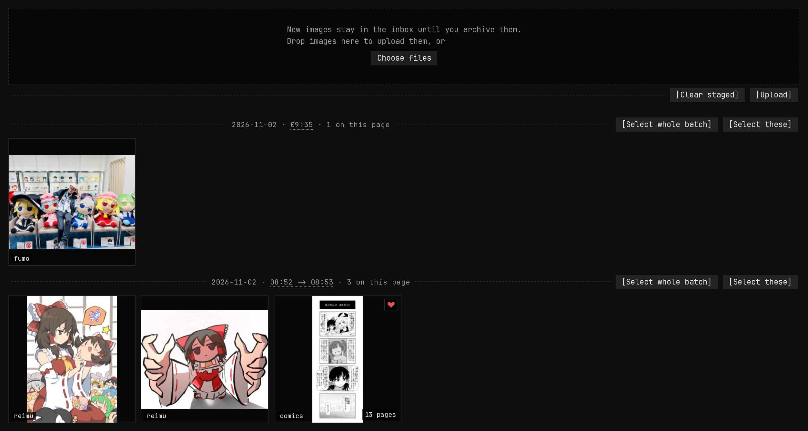

Every new image lands in the **inbox**, however it arrived: dropped
into a folder, uploaded, pushed by monloader. The inbox is your "not
looked at yet" pile. Once an image's tags and rating are right, move
it to the **archive**, and new arrivals never get mixed in with the
part of your library you've already sorted.

The inbox is a search, `inbox:true`, so every filter and sort
works on it. `inbox:false` is the archive.

Press `i` on an image's page to move it between inbox and archive, or
tick a batch of thumbnails and do them all from the batch bar. To add
files from the browser, drop them on the drop zone at the top of the
inbox.

## Batches

When the inbox is sorted newest first, images are grouped by how they
arrived: each upload is its own group, and files that showed up on
disk are grouped by time. **[Select whole batch]** on a group's header
ticks the whole group, even across pages, so you can tag or archive
one download in a single go.
