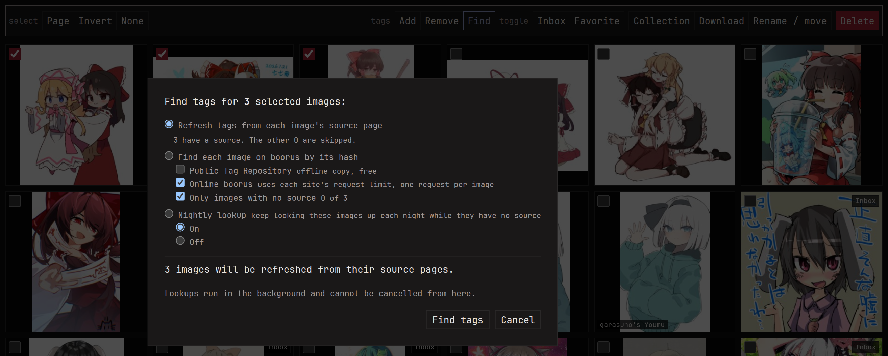

A lookup asks the internet about one of your images: where does this
picture come from, and how do other people tag it? A hit adds the
source to the image and brings its tags in, which is a quick way to
tag a pile of downloaded art you never got around to.

monbooru itself never goes online, so lookups go through a paired
[monloader](../../addons/monloader/_index.md). The
[addons quick start](../../addons/quick-start.md) sets one up in a few
minutes, and the lookup buttons appear once the two are paired. How
monloader searches (which sites, in what order, how close a match has
to be) is on the [monloader lookup page](../../addons/monloader/guides/lookup/index.md).

There are two places to look:

- **Online boorus**, by the file's hash, and by image similarity
  through IQDB and SauceNAO. Boorus know files by their original hash,
  so a resized or re-saved copy usually only turns up similar-looking
  candidates, each with a match percentage.
- **The Hydrus Public Tag Repository (PTR)**, a big shared tag
  database, if monloader keeps a local copy of it. See
  [Hydrus PTR](../../addons/monloader/guides/ptr/index.md).

## Running lookups from monbooru

On an image's page:

- **Lookup online boorus** (or `L`) searches the boorus for this image.
- **Pull tags**, in the **Public Tag Repository** panel, brings in the
  tags the PTR has for this image.
- **refresh** on a source fetches that post again, for new tags,
  commentary and notes. Tags the source dropped are kept but marked
  `stale` (see [Tags](../tags/index.md#where-tags-come-from)).
- **upgrade** shows up on a source when it has a different file from
  yours, usually a bigger one. It downloads the post's file and swaps
  it in place of yours, keeping the image's tags, sources and
  relations. Your old file is gone after that, so it asks first.

For many images at once, tick them (or take the whole search) and
press **Find tags** in the batch bar. It can refresh every source the
images have, look them up by hash, or switch them in or out of the
nightly lookup below.

## Looking up a library overnight

Looking up a whole library by hand is slow, and doing it in one batch
can burn through a site's request allowance. The
[nightly run](../maintenance.md#nightly-schedule) can do it a little
at a time instead: tick either lookup under **Settings -> Schedule**
and each night it works through the images that have no source yet.

- The **Public Tag Repository** pass is a local read and costs nothing,
  so it goes through every waiting image each night, and tries again
  when monloader's copy of the PTR gets new data.
- The **online boorus** pass costs a real request per image, so
  monloader only accepts so many a day; set that under monloader's
  **Settings -> lookup**. When the day's allowance runs out, the pass
  picks up where it stopped the next night.

An image that isn't found waits longer and longer before the next try,
and after a handful of misses online it's marked **nothing found** and
left alone. Its page offers **look again** if you think that's wrong.

Each image without a source also has a switch per pass, so you can
keep your own drawings or commissions out of the online lookups (no
booru will ever have them) while the free PTR pass still runs. In the
schedule you can leave a whole gallery out, your photos for instance.
