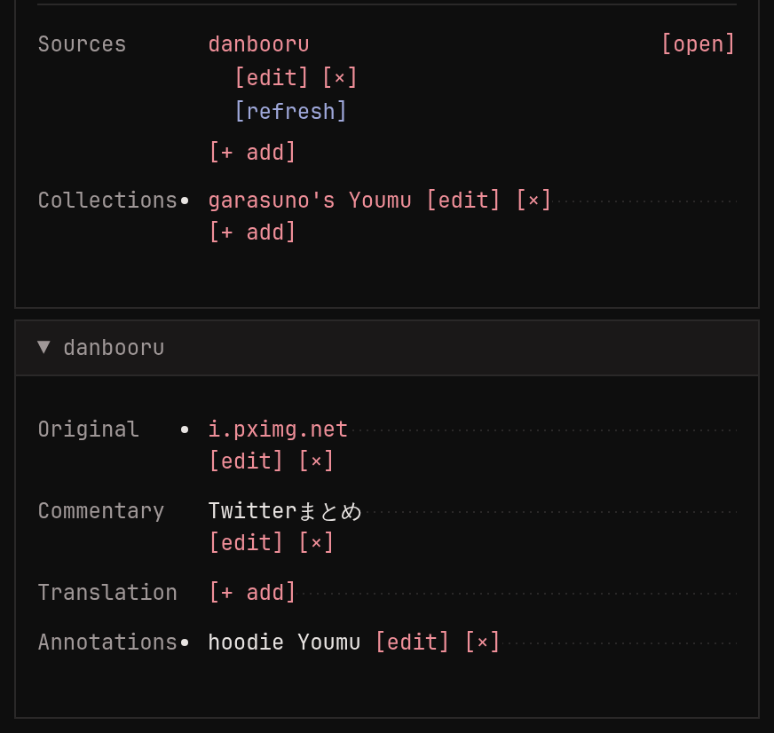
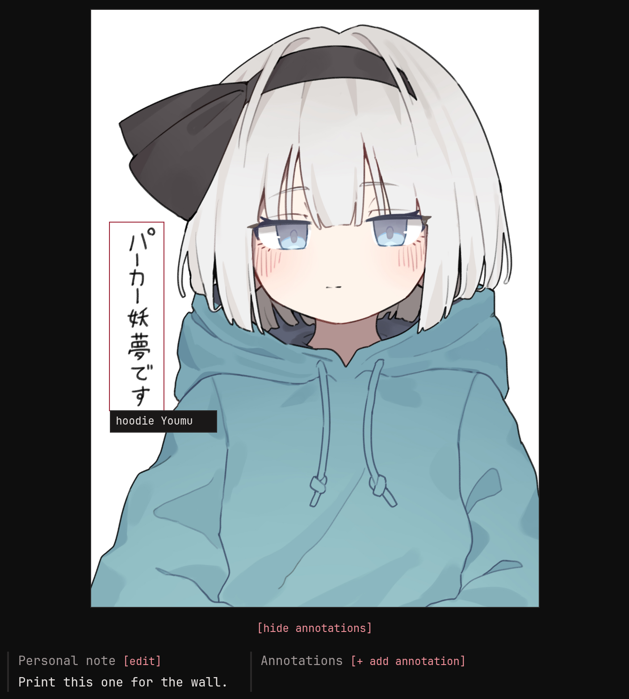

Besides its tags, an image can remember where it came from and what
you know about it. All of it is on the image's page.

## Sources



A source is a link to where the image lives online: a booru post, an
artist's page. An image can have several. monloader adds them when it
downloads or [looks an image up](../lookup/index.md), and **[+ add]**
records one by hand. **[set primary]** picks the one listed first.

Open a source and it shows what the booru post said about the image:
the artist's original upload it points to (often a pixiv or twitter
link), the artist's own title and description, and a translation when
the booru has one. You can edit these by hand too.

Sources are also what [lookups](../lookup/index.md#running-lookups-from-monbooru)
refresh, and what an upgrade to a bigger file comes from.

## Personal note

A free-text note on the image, just for you (`e n` to edit it).



## Annotations

Annotations are boxes drawn on the image with some text, the way
boorus mark up translated speech bubbles. A booru lookup brings in the
post's annotations, and you can draw your own on the image's page.
They show when you hover over the image; hovering one in the list
highlights its box, and **[hide annotations]** hides them all.

## Formatting

Notes, annotations, tag notes and commentary understand a little
markup:

```
[b]bold[/b]  [i]italic[/i]  [u]underline[/u]  [s]struck[/s]
[code]code[/code]  [tn]translator note[/tn]

[tag]blue_eyes[/tag]              a search for that tag
[tag=blue_eyes]Blue eyes[/tag]    the same, with your own wording
[url=https://example.com]link[/url]
[image:123]                       another image in this gallery
```
