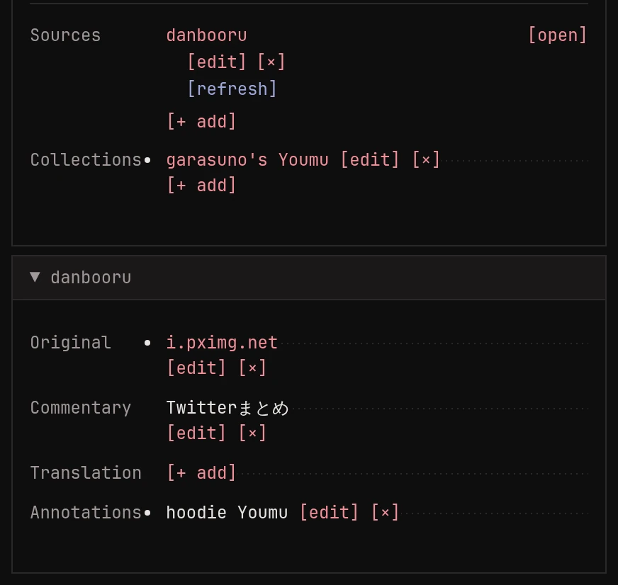
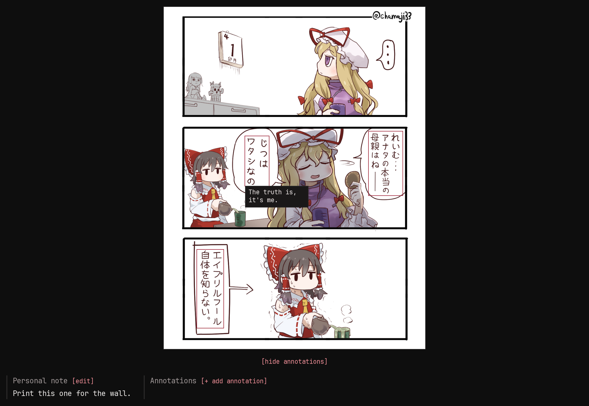

Besides its tags, an image can remember where it came from and what
you know about it. All of it is on the image's page.

## Sources

A source is a link to where the image lives online: a booru post, an
artist's page. An image can have several. monloader adds them when it
downloads or [looks an image up](../lookup/index.md), and you can add
your own.

Open a source and it shows what the booru post said about the image:
the artist's original upload it points to (often a pixiv or twitter
link), the artist's own title and description, and a translation when
the booru has one. You can edit these by hand too.

Sources are also what [lookups](../lookup/index.md#running-lookups-from-monbooru)
refresh, and what an upgrade to a bigger file comes from.

## Personal note

Each image can carry a free-text note of your own. Press `e n` to
edit it.

## Annotations

Annotations are boxes drawn on the image with some text, the way
boorus mark up translated speech bubbles. A booru lookup brings in the
post's annotations, and you can draw your own on the image's page.
The boxes are outlined on the image, and hovering one shows its text.

## Formatting

Notes, annotations, tag notes and commentary understand a little
markup, like `[b]bold[/b]` or `[tag]blue_eyes[/tag]` for a link to
that tag's search. The bar above each editor adds the markup for you,
and **[preview]** shows the result.
