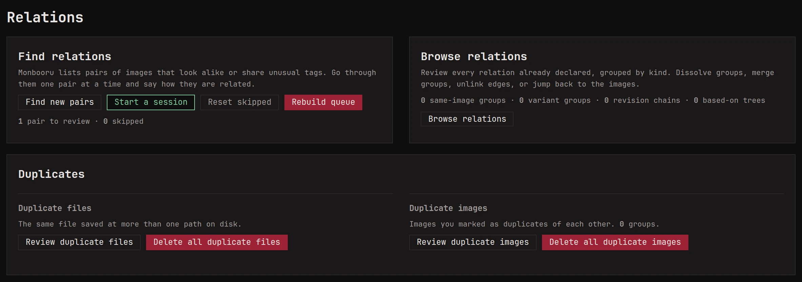
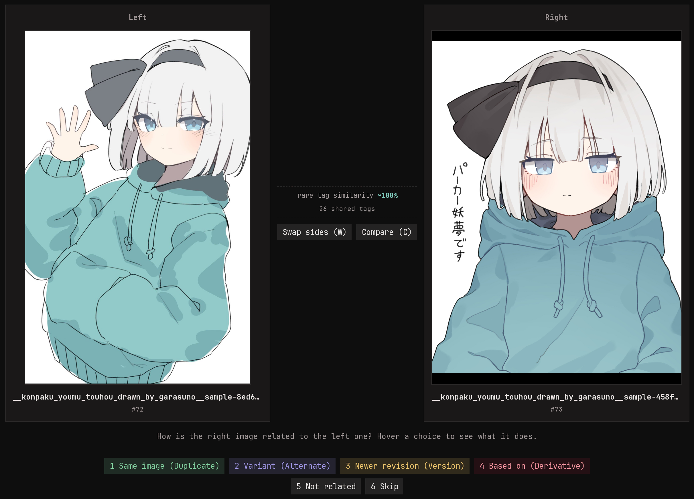

Collections that grow over years pick up near-copies: the same picture
saved twice at different sizes, a recoloured version, a sketch and the
finished piece, an edit of someone else's work. Relations let you say
how two images are related, and monbooru helps you find the pairs.

## The four kinds

| Relation | Means |
|---|---|
| Duplicate | The same picture in different files. One of them is the **original**, the copy you keep. |
| Alternate | The same subject, drawn or rendered differently. No member is special. |
| Version | An earlier and a later version of one picture, in a chain. |
| Derivative | An image based on another: an edit, a crop, a composite. A composite can have several sources. |

Marking a pair **Not related** stops monbooru from suggesting it
again.

To declare a relation yourself, use **Add a relation** on an image's
page. When monloader downloads a booru post that names a parent post,
the two are linked as a derivative once both are in your gallery.

[Collections](../collections/index.md) are a separate, lighter way to
group images.

## Finding candidate pairs

monbooru keeps a fingerprint of what each image looks like, one that
survives resizing and re-encoding, and suggests pairs of images whose
fingerprints are close. New images are checked as they arrive.
**Relations -> Find new pairs** checks everything added since the last
time, and the nightly run can do it for you (see
[Maintenance](../maintenance.md#nightly-schedule)).

**Settings -> Relations -> How alike images must look** says how
different two images may look and still be paired: lower means fewer
pairs, but surer ones.

A recolour or a redraw looks too different for the fingerprint, so
monbooru also pairs images that share rare tags, the ones few of your
images carry. This only helps once your images are tagged, and it
makes **Find new pairs** slower, so untick **Also queue pairs that
share rare tags** under **Settings -> Relations** if your library is
big and mostly untagged. Lowering **Rare tag similarity match
strength** finds more variants and makes a longer queue.

## The swipe session

**Relations -> Start a session** shows you the queued pairs side by
side, one at a time. Decide what each pair is, or skip it for later.
The line between the two images says why they were paired: how close
their fingerprints are, which rare tags they share, or both.

Marking a pair **Duplicate** keeps the image on the left as the
original and offers to delete the file on the right. If the right one
has tags the left one lacks, you can copy them over first.

## Browsing and undoing

**Relations -> Browse relations** lists everything you declared, one
tab per kind, **Not related** included. From there you can unlink a
pair, break up a group, or send a pair back to a session with **Review
again** when you change your mind.

## Cleaning up duplicates

**Relations -> Duplicates** has two tools, for two different problems:

- **Duplicate images** goes through the duplicate groups you declared,
  two different files you said are the same picture. It deletes the
  copies and keeps the original, and **[copy tags]** first copies the
  copies' tags onto the original.
- **Duplicate files** goes through files that are byte-for-byte
  identical but stored in more than one place on disk. monbooru already
  treats them as one image, so this only deletes the extra files.
