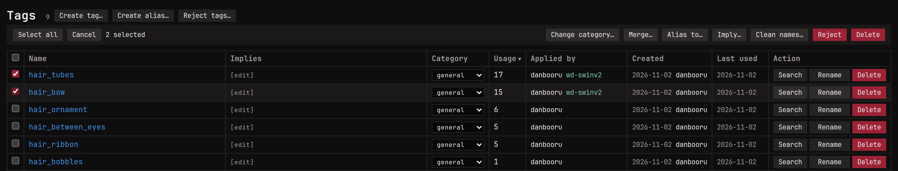

Tags from several sites and models end up with more than one name for
the same thing, and with names you never wanted. Aliases fold the
spellings into one, implications add the tags that always go together,
and rejected names keep the unwanted ones out.

## Aliases and implications

People use different tags for the same thing: `blond_hair` and
`blonde_hair`, or a character's name in two orders. An **alias**
points one spelling at another, so tagging or searching with
`blond_hair` gives you `blonde_hair`.

On the Tags page, select the spellings you want to fold away and use
**Alias to**: their images move to the target and the old names stay
behind as aliases. **Merge** does the same among the selected tags,
keeping the one you pick. **Rename** can keep the old name as an alias
too, so saved searches that use it keep working.

An **implication** says one tag always brings another along:
`hatsune_miku` implies `vocaloid`. Declare it with **Imply** on the
Tags page, or in the **Implies** list on the tag's own page, and every
image with `hatsune_miku`, now and later, gets `vocaloid` too. Implied
tags are real tags as far as search is concerned. In an image's tag
list they sit indented under each tag that brought them, and leave
when it does.

With monloader and its copy of the Public Tag Repository set up,
**Find aliases and implications** on the Tags page fetches the aliases
and implications the PTR knows for the selected tags. It only adds;
nothing is removed or sent anywhere.

The same name can sit in two categories as two different tags, like
`artist:kirin` and `character:kirin`. The Tags page lists those under
**Conflicts**, where you merge the ones that were filed twice.

An artist's other names, like the ones Danbooru lists, go in as
aliases on the artist's own page, in any script, so tagging or
searching with any of them lands on the artist.

A tag no image uses any more stays on the Tags page until you delete
it.

## Rejected names

Some names you never want, whichever site, model or import brings them.
**Reject tags** on the Tags page takes a list of names, strips them from
every image and keeps them out from then on. Deleting a tag offers
**Delete and reject** to do both at once. The **Rejected** filter on
the Tags page lists them, each with **Un-reject** to let it back in.

Rules for one site or one auto-tagger are set elsewhere:
[What applies when](../../addons/monloader/guides/mapping/index.md#what-applies-when)
says which rule goes where.

A tag's own page draws **Where this tag comes from**: every source that
can bring the tag, and where a rule stops it on the way. Click a box to
open the place that step is edited.
