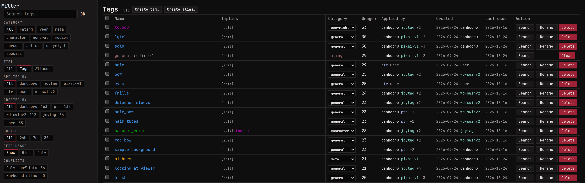

A tag is a short label for one thing about a picture: `red_hair`,
`beach`, `hakurei_reimu`, `2003`. Give each image a few and you can
combine them in a search to narrow thousands of images down to the
handful you want.

## Adding tags

Type tags into the tag box on an image's page, separated by spaces. A
tag can't contain a space, so a multi-word tag uses underscores, or
quotes that do it for you: `"john doe"` becomes `john_doe`. Names are
lowercase and can use almost any character except spaces, quotes and
`*`, so `girls'_frontline`, `fate/grand_order` and `東方project` all
work.

To tag many images at once, tick them in the gallery and press
**Add** in the batch bar's tags group. **Remove** next to it takes
tags off again, by name or by where they came from.

In an image's tag list, click a tag to search for it. The `?` in front
of it opens the tag's own page (see [Notes and links](#notes-and-links)).

## Categories

Every tag sits in a category, which says what kind of thing it names
and gives it a colour: `general` for what's in the picture,
`character`, `artist`, `copyright` for the series or franchise, `meta`
for things about the file, plus `medium`, `person`, `year`, `species`
and `rating`. Put the category in front when you type:
`artist:"john doe" blue_eyes 1girl` adds `john_doe` as an artist and
the other two as general tags.

The **Categories** page lets you recolour categories, add your own and
change their order: drag a row to move its group of tags up or down on
the image page and in the gallery sidebar.

The same name can sit in two categories as two different tags, like
`artist:kirin` and `character:kirin`. The Tags page lists names like
that under **Conflicts**, since most of them are one tag filed twice
that you'll want to merge. When the two really are different things,
select them and use **Mark distinct**, and they stop showing up there.

## Ratings and the SFW ceiling

A rating says how safe an image is to have on screen, from `general`
through `sensitive` and `questionable` to `explicit`. An image has one
rating. Adding another replaces it, and yours always wins over an
auto-tagger's.

The rating buttons in the footer set the **SFW ceiling**: click
`sfw` and everything rated above `general` disappears from the gallery,
related images and anything else you browse. Batch actions on "the
whole search" respect it too, so they never touch an image you can't
see. Click `explicit` to turn it off again. Each browser remembers its
own ceiling.

Only those four ratings exist. If an imported library has its own
spelling for them, like a `safe` or `nsfw` tag, fold it in: select the
tag on the Tags page, use **Alias to** with `rating:general` (or
whichever level fits) as the target, and its images pick up that
rating. An image already rated higher keeps its level.

## Where tags come from

A tag can come from several places: you, an auto-tagger, a booru that
monloader pulled from, the Hydrus Public Tag Repository, or monbooru
itself. monbooru keeps track of each one separately, and an image's tag
list shows it next to the tag:

- `87%`: only an auto-tagger vouches for this tag, and that's how sure
  it was. The number goes away once you or a booru apply the tag too.
- `x3`: three sources agree on it.
- Struck through and marked `stale`: the source that gave you the tag
  stopped listing it the last time it was refreshed. The tag stays
  until you decide; **remove all** at the bottom of the list clears
  every stale tag at once.

The **group by: [category] / [source]** switch above the list regroups
it by source, so you can see what each one added. Removing a tag in
that view only removes that source's copy: if another source also has
the tag, it stays.

You can search on all of this: `tagged:user` finds images you tagged
yourself, `tagged:danbooru` the ones danbooru tagged,
`autotagged:false` the ones no auto-tagger has seen, and `stale:any`
the ones with stale tags.

### Tags monbooru adds by itself

Some things can be read straight from the file, so monbooru tags them
as images arrive: the size (`highres`, `absurdres`, `lowres`), an odd
shape (`wide_image`, `tall_image`), what it is (`video`, `animated`,
`sound`), and a few more like `greyscale` and `ai-generated`. They go
in `meta` and follow Danbooru's names and rules, so a picture pulled
from there and one you tagged at home agree on what counts as
`highres`.

They don't count as tagging: `tagged:false` still finds an image
nobody has tagged. They also follow the file, so replace a picture with
a bigger version and `lowres` gives way to `highres`. The switch is
under **Settings -> General**, and **Settings -> Maintenance** can add
them to the images you already have or take them all off.

## Aliases and implications

People use different tags for the same thing: `blond_hair` and
`blonde_hair`, or a character's name in two orders. An **alias**
points one spelling at another, so tagging or searching with
`blond_hair` gives you `blonde_hair`.

On the Tags page, select the
spellings you want to fold away and use **Alias to**: their images
move to the target and the old names stay behind as aliases. **Merge**
does the same among the selected tags, keeping the one you pick.
**Rename** can keep the old name as an alias too, so saved searches
that use it keep working.

An **implication** says one tag always brings another along:
`hatsune_miku` implies `vocaloid`. Declare it with **Imply** on the
Tags page or on the tag's own page, and every image with
`hatsune_miku`, now and later, gets `vocaloid` too. Implied tags are
real tags as far as search is concerned. In an image's tag list they
sit indented under each tag that brought them, and leave when it does.

With monloader and its copy of the Public Tag Repository set up,
**Find aliases and implications** on the Tags page fetches the aliases
and implications the PTR knows for the selected tags. It only adds;
nothing is removed or sent anywhere.

Tags are never deleted behind your back. A tag no image uses any more
stays on the Tags page with a count of zero until you delete it.

## Notes and links

Every tag has its own page, opened with the `?` in front of it in any
tag list. It holds a note about what the tag means to you and a list
of links (an artist's pages, a series' official site), along with the
tag's aliases and implications. The note takes the same
[formatting](../provenance/index.md#formatting) as image notes, so it
can point at other tags with `[tag]...[/tag]`.

An artist's other names, like the ones Danbooru lists, go in as
aliases on that page, in any script, so tagging or searching with any
of them lands on the artist.
